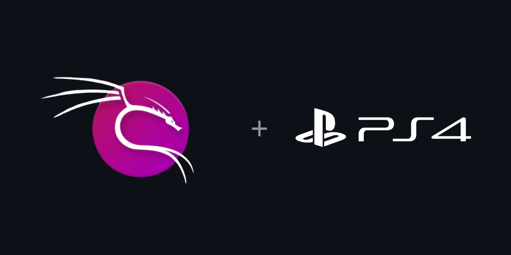
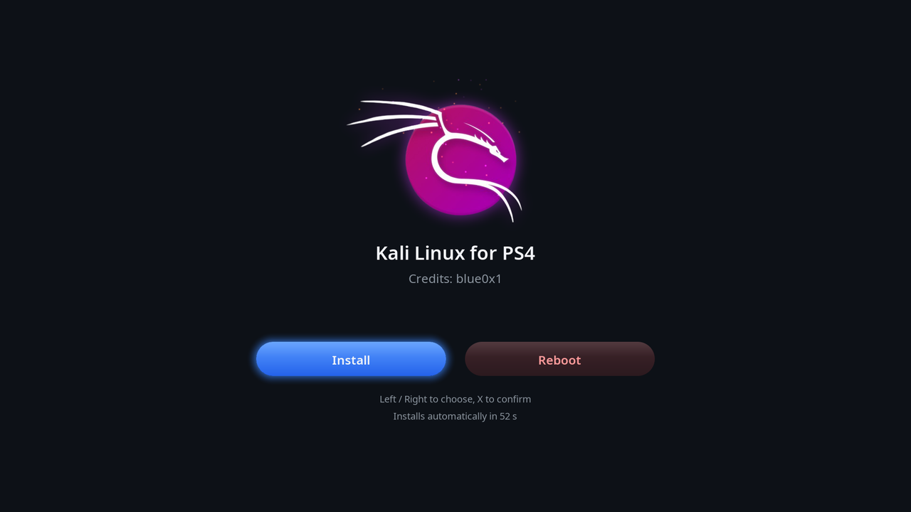
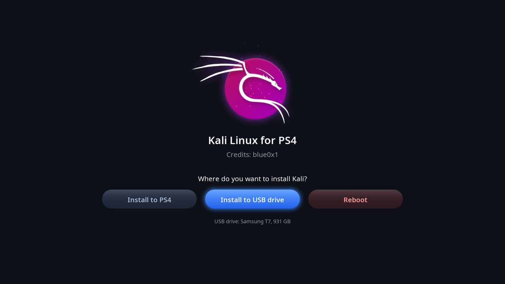
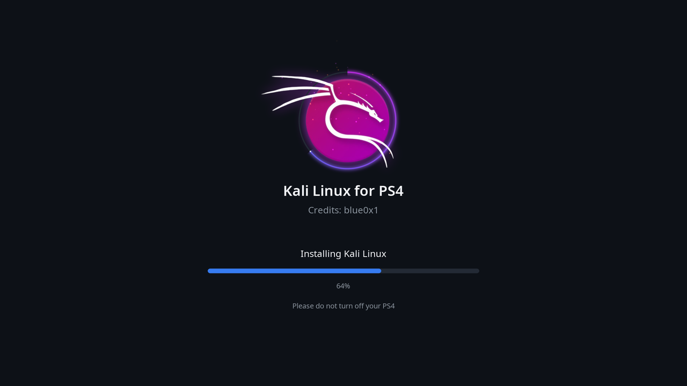

<p align="center">
  
</p>

<h1 align="center">Kali Linux for PS4</h1>

<p align="center">
  <a href="https://github.com/blue0x1/kali-ps4/releases"></a>
  <a href="LICENSE"></a>
  
  
  
  
  <a href="https://github.com/blue0x1/kali-ps4/stargazers"></a>
</p>

Kali Linux with the XFCE desktop for jailbroken PlayStation 4 consoles, with a graphical installer that runs on the TV. No PC tools, partitioning or USB stick are needed: copy five files to the PS4 over FTP, run the payload, press **Install**.


## Features

- **Installer on the TV**: the Kali logo forms from glowing embers, then you choose **Install to PS4**, **Install to USB drive** or **Reboot**. A progress ring and bar show the install, about 10 to 15 minutes.
- **Controller support**: a DualShock 4 on a USB cable (left/right to choose, X to confirm, Circle to go back) or a USB keyboard. With no input, it installs to the PS4 after 60 seconds.
- **Installs into a single file** on the PS4's internal drive (`/user/home/kali-ps4.img`). The PS4 system software and its other data are not touched, and nothing is repartitioned.
- **Or onto an external USB drive** (stick, hard drive or SSD). Kali then boots from the drive whenever it is plugged in.
- **Kali rolling with XFCE**, about 3.6 GB installed.
- **PS4 Pro HDMI fixes** for the MN864729 HDMI bridge: kernel patches plus a keep-alive helper.

## Screenshots







## Tested hardware

| Console | Firmware | Result |
|---|---|---|
| PS4 Pro CUH-7016B (Belize) | 14.00, GoldHEN | Works: install to PS4 and to USB, desktop, controller |

Other models should work wherever the [ps4-linux](https://github.com/sony-jaguar-devs/ps4-linux) kernel supports them, but they are untested. Reports are welcome.

## Requirements

- A jailbroken PS4 with **GoldHEN** (for its FTP server and payload loader).
- A PC on the same network with an FTP client (for example FileZilla). or ftp client in iPhone/Android
- **To install to the PS4:** about 28 GB free on the PS4. The installer creates a 16 GB Kali disk and always leaves 10 GB free for the PS4. With less space it makes a smaller disk (at least 8 GB).
- **To install to USB:** a drive of 8 GB or more. It will be erased. A USB 3 drive or an external SSD is much faster than a USB 2 stick.
- Optional: a DualShock 4 with a USB cable, or a USB keyboard.

## Install

1. Download these files from the [Releases](../../releases) page:
   `bzImage`, `initramfs.cpio.gz`, `bootargs.txt`, `kali-ps4-rootfs.tar.xz`, `linux-2048mb.bin`

2. Turn on GoldHEN's FTP server and copy the files to the PS4 (port 2121):

   | File | Folder on the PS4 |
   |---|---|
   | `bzImage`, `initramfs.cpio.gz`, `bootargs.txt` | `/data/linux/boot/` |
   | `kali-ps4-rootfs.tar.xz` | `/user/home/` |
   | `linux-2048mb.bin` | `/data/payloads/` |

3. Optional: plug in the controller with its USB cable. To install to USB, plug in that drive, and only that one.

4. Run `linux-2048mb.bin` from GoldHEN's payload menu, or send it to GoldHEN's BinLoader on port 9090.

   > **Be patient:** after the payload starts, the TV can show **"No signal" or a black screen for 1 to 2 minutes** while Linux starts and the HDMI output comes up. This is normal. Wait before you restart anything.

5. In the installer, pick where to install and press **X**. Choosing the USB drive asks for confirmation first, because the drive is erased. Don't turn the PS4 off until Kali has started. The **Finishing** step at 100% can take a few minutes on a slow USB stick.

Log in with user **`kali`**, password **`kali`**, and change the password right away with `passwd`. The SSH server is on, so anyone on your network can log in with the default password until you change it. Turn SSH off with `sudo systemctl disable --now ssh`.

## Everyday use

Start GoldHEN and run the payload: the PS4 boots straight into Kali. Give it 1 to 2 minutes: the screen can stay black or show "No signal" before the picture appears. It uses the USB drive if one with Kali is plugged in, otherwise the internal install. Shut down or restart from Kali to go back to the PS4 system.

## Reinstall or remove

- **Reinstall on the PS4:** delete `/user/home/kali-ps4.img` over FTP. The installer appears on the next boot.
- **Remove completely:** also delete `/user/home/kali-ps4-rootfs.tar.xz` and the three files in `/data/linux/boot/`.
- **USB install:** reformat the drive on a PC.

## Troubleshooting

| Problem | Fix |
|---|---|
| "No signal" or a black screen | First wait 1 to 2 minutes: this is normal while Linux starts. If there is still no picture after that, the HDMI link did not come up on this boot (it happens now and then). Hold the power button to turn the PS4 off, switch the TV off and on, and try again. |
| Controller does nothing in the installer | Connect it with a USB cable. Bluetooth is not available until Kali is running. |
| "Not enough free space on the PS4" | Free up space on the PS4 (about 28 GB is ideal, 19 GB is the minimum), or install to a USB drive. |
| A text console with a rescue shell | No Kali install was found. Check that the files are in the right folders. |

## Build from source

You need a Linux PC with Docker, git, make and about 30 GB of free disk space.

```bash
make             # kernel, installer (initramfs) and the Kali desktop archive
make ps4-files   # copies the files for the PS4 into ps4-files/
```

`ps4-files/` mirrors the PS4's folders (`data/linux/boot`, `user/home`). The Linux loader payload (`linux-2048mb.bin`) is not built here: it comes from the community PS4 Linux Loader.

| Variable | Default | Meaning |
|---|---|---|
| `PROFILE` | `desktop` | `desktop` (XFCE) or `minimal` (text console) |
| `TOOLS` | `none` | Kali metapackage to preinstall, for example `kali-tools-top10` |
| `KERNEL_BRANCH` | `7.0-Clean` | Branch of the PS4 kernel tree |
| `KERNEL_REPO` | sony-jaguar-devs/ps4-linux | Kernel tree to build |

Individual steps: `make kernel`, `make initramfs`, `make rootfs`. To write a bootable USB drive on the PC instead of using the installer, run `make usb DEVICE=/dev/sdX`. This erases the drive.

Kernel command-line options handled by the initramfs (in `bootargs.txt`):

| Option | Effect |
|---|---|
| `kali_root=LABEL=…` / `UUID=…` / `/dev/…` | Boot a different root partition |
| `kali_rootwait=30` | Wait longer for a slow USB drive |
| `kali_rescue` | Open a shell before mounting root |

## Project layout

| Path | Contents |
|---|---|
| `initramfs/init` | Boot logic: finds Kali on USB or on the PS4 drive, runs the installer on first boot |
| `initramfs/fbui.c` | The installer screens: animation, buttons, progress, controller input |
| `initramfs/blockmap.c` | Maps `kali-ps4.img` on the PS4 drive without writing the PS4's file system |
| `initramfs/ps4hdmi.c` | Keeps the PS4 Pro HDMI output on during boot |
| `patches/kernel/` | HDMI bridge fixes for the PS4 kernel |
| `scripts/`, `docker/`, `config/`, `overlay/` | Build system, Kali package lists and files added to Kali |
| `assets/`, `tools/` | Logo, font generator, HDMI bridge debugging tool |


## License

Copyright (C) 2026 [Chokri Hammedi (blue0x1)](https://github.com/blue0x1).

The project code is GPL-2.0 (see `LICENSE`). The release files also contain the Linux kernel (GPLv2), BusyBox (GPLv2) and Kali packages under their own licenses. If you redistribute them, you must also offer the matching sources. The kernel commit is recorded in `kernel.info` in each release.
